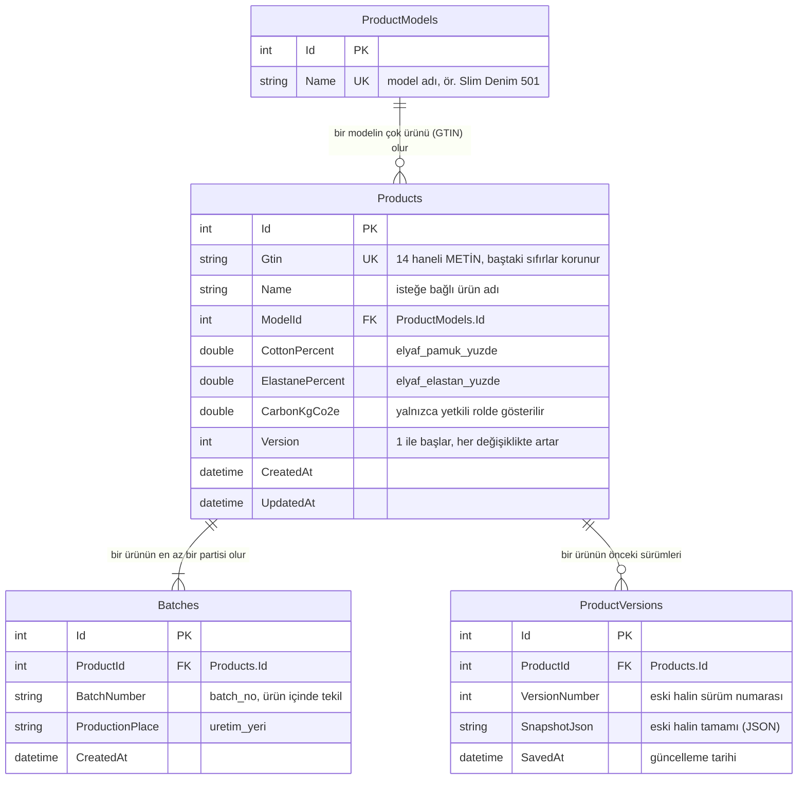
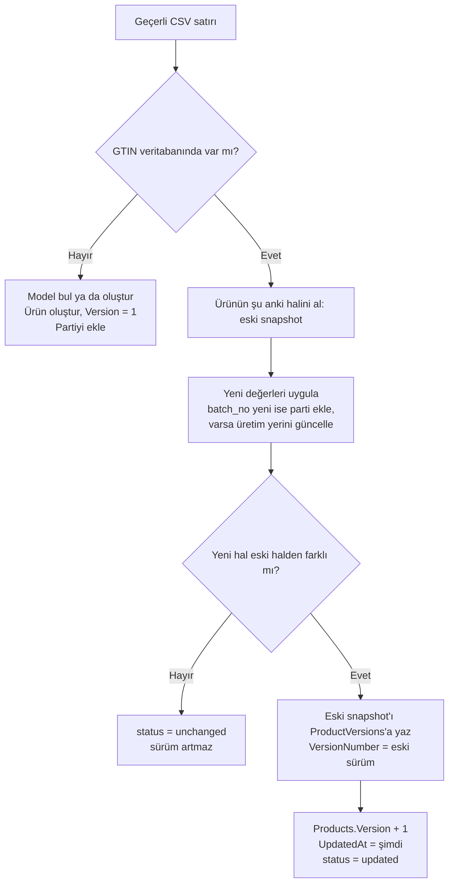
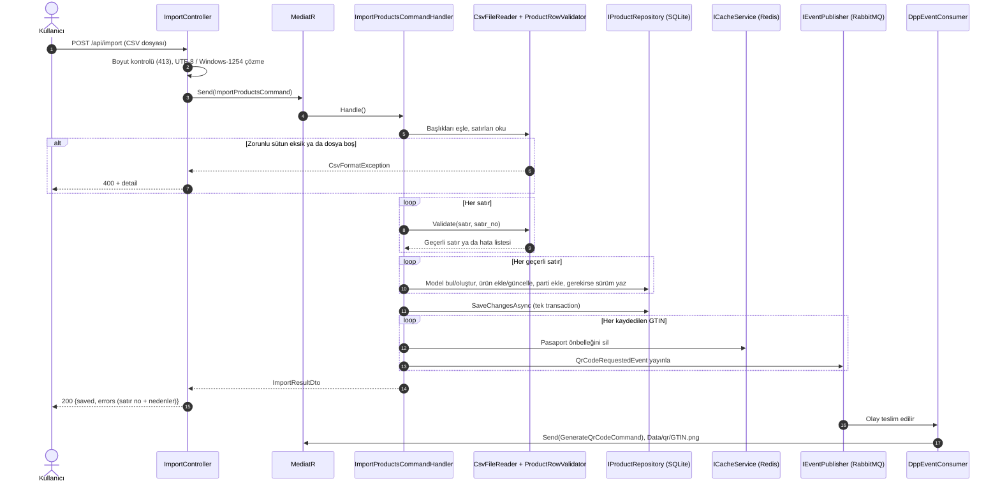
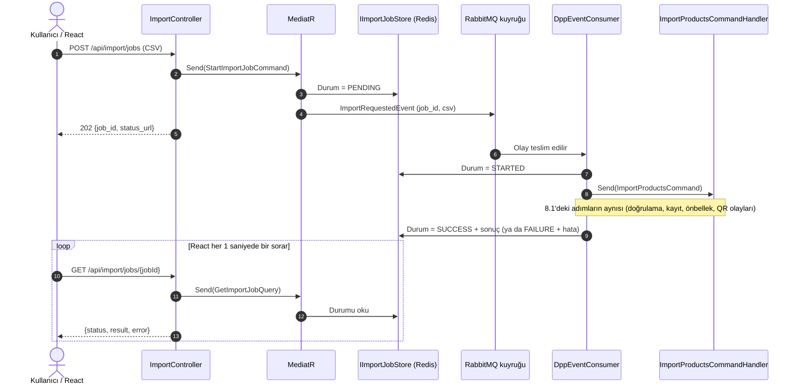
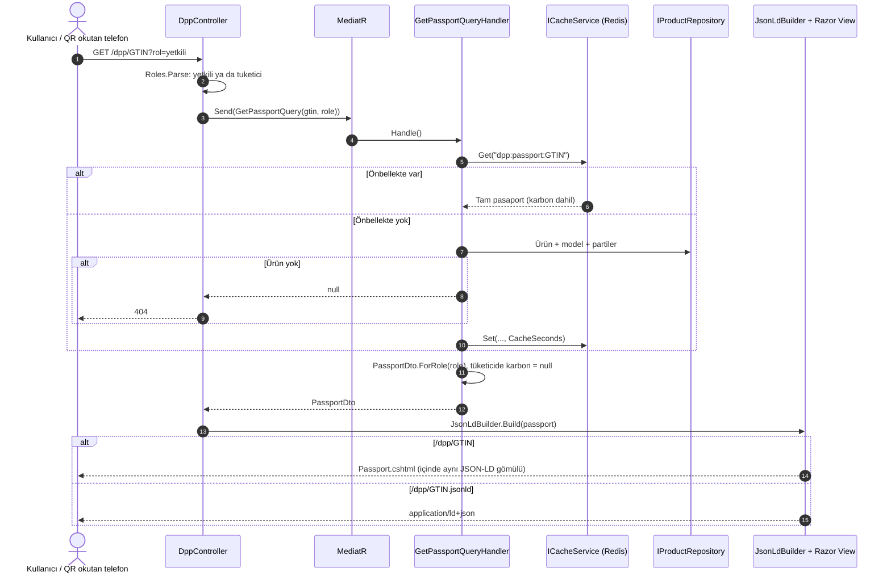
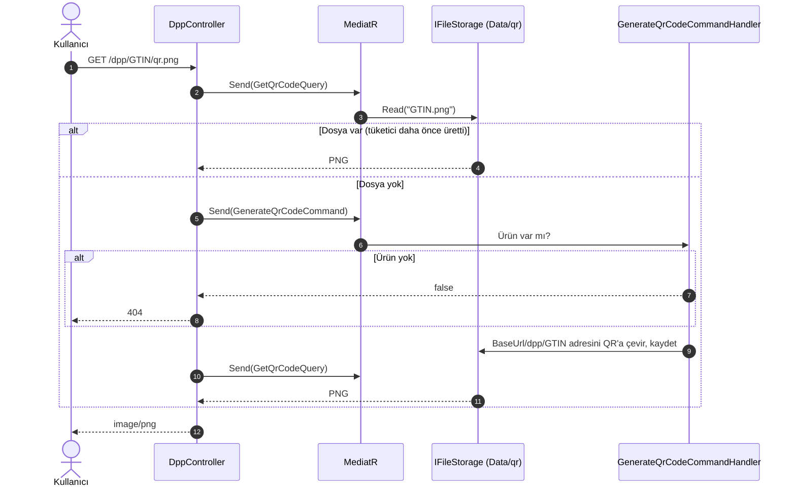

# case_work — Mini Dijital Ürün Pasaportu (Mini DPP)

ESG Next teknik değerlendirme ödevi. .NET 8 Web API (MVC) + React/TypeScript arayüz.
CSV'deki denim ürünlerini okur, doğrular, geçerli kayıtları SQLite'a yazar ve her ürün için
**HTML pasaport**, **JSON-LD (schema.org/Product)** ve **QR kod (PNG)** üretir.

> **Hiçbir şey kurmadan denemek için:** [](https://codespaces.new/enesorhann/case_work?quickstart=1)
> — tarayıcıdan, her cihazda çalışır (bkz. [2-A](#a-hiçbir-şey-kurmadan-github-codespaces-önerilen)).

| Konu | Teknoloji |
|---|---|
| API | ASP.NET Core 8 (MVC: Controller + Razor View) |
| CQRS / Mediator | MediatR (Command / Query handler'ları) |
| Veritabanı | SQLite + EF Core (migration'lar uygulama açılışında uygulanır) |
| Nesne dönüşümü | AutoMapper |
| Önbellek | Redis (StackExchange.Redis) |
| Arka plan işleri | RabbitMQ (yayıncı + `BackgroundService` tüketici) |
| QR kod | QRCoder |
| Arayüz | React 18 + TypeScript + Vite |
| Test | xUnit + WebApplicationFactory |

## İçindekiler

1. [Gereksinimler](#1-gereksinimler)
2. [Kurulum — adım adım](#2-kurulum--adım-adım)
3. [Servisler](#3-servisler)
4. [Çalıştırma notları](#4-çalıştırma-notları)
5. [Mimari ve klasör yapısı](#5-mimari-ve-klasör-yapısı)
6. [CSV içe aktarma ve doğrulama](#6-csv-içe-aktarma-ve-doğrulama)
7. [Veritabanı (ERD)](#7-veritabanı-erd)
8. [API endpoint'leri ve akışları](#8-api-endpointleri-ve-akışları)
9. [curl ile uçtan uca örnek akış](#9-curl-ile-uçtan-uca-örnek-akış)
10. [Postman koleksiyonu](#10-postman-koleksiyonu)
11. [RabbitMQ olayları](#11-rabbitmq-olayları)
12. [Redis önbelleği](#12-redis-önbelleği)
13. [Tasarım varsayımları](#13-tasarım-varsayımları)
14. [Ayarlar](#14-ayarlar)
15. [Testler](#15-testler)

---

## 1. Gereksinimler

Üç çalıştırma yolu var; birini seçmeniz yeterli:

| Yol | Gereken | Hangi cihazda |
|---|---|---|
| **A) GitHub Codespaces (önerilen)** | Yalnızca bir GitHub hesabı ve tarayıcı. Bilgisayara **hiçbir şey kurulmaz**. | Windows, macOS, Linux, Chromebook, tablet, telefon — tarayıcısı olan her cihaz |
| B) Docker | [Docker Desktop](https://www.docker.com/products/docker-desktop/) | Windows, macOS, Linux |
| C) Docker olmadan | [.NET 8 SDK](https://dotnet.microsoft.com/download/dotnet/8.0) ya da daha yenisi (ör. .NET 10) ve [Node.js 20+](https://nodejs.org/) | Windows, macOS, Linux |

Proje .NET 8'i hedefler; makinede yalnızca .NET 10 varsa uygulama onunla çalışır (`RollForward=Major`),
testler de .NET 10 SDK ile otomatik olarak `net10.0` hedefiyle derlenir.

## 2. Kurulum — adım adım

### A) Hiçbir şey kurmadan: GitHub Codespaces (önerilen)

Uygulama GitHub'ın bulut makinesinde çalışır, siz tarayıcıdan kullanırsınız. Bilgisayarınızın işletim sistemi önemli
değildir. Gerekli her şey (.NET 8, Node.js, Redis, RabbitMQ) [.devcontainer/](.devcontainer/) klasöründeki ayarlarla
otomatik kurulur.

[](https://codespaces.new/enesorhann/case_work?quickstart=1)

1. **Codespace'i açın:** GitHub'a giriş yapın ve yukarıdaki **Open in GitHub Codespaces** düğmesine basın
   (ya da repo sayfasında **Code → Codespaces → Create codespace on main**).
2. **Bekleyin:** ilk açılışta kurulum 2–4 dakika sürer. Bu sırada React arayüzü derlenir, .NET paketleri indirilir.
   Sonra uygulama **kendiliğinden başlar**; terminalde `Now listening on: http://localhost:8080` yazısını görürsünüz.
3. **Uygulamayı açın:** genelde yeni sekmede kendiliğinden açılır. Açılmazsa alttaki **Ports** sekmesinde
   **Mini DPP (8080)** satırındaki 🌐 simgesine basın. Adres şu biçimdedir: `https://<codespace-adı>-8080.app.github.dev`
4. **Ödev CSV'sini yükleyin:** arayüzde dosya seçip **Yükle** deyin. Dosya cihazınızda yoksa Codespace'te yeni bir
   terminal açıp (**Terminal → New Terminal** ya da terminal panelindeki **+**) şunu çalıştırın, sonra sayfayı yenileyin:

   ```bash
   curl -F "file=@Data/urunler_duzeltilmis_test.csv" localhost:8080/api/import
   ```

5. **QR kodu telefonla okutmak için:** başlangıç betiği 8080 portunu otomatik olarak **Public** yapmayı dener ve sonucu
   terminale yazar. Olmadıysa **Ports** sekmesinde 8080'e sağ tıklayın (telefonda basılı tutun) →
   **Port Visibility → Public**. Aksi halde QR'ı okutan cihazdan GitHub girişi istenir.
   QR kodlar Codespaces adresiyle üretilir; bunun için ayrıca bir ayar yapmanız gerekmez.

Notlar:
- **Kapatıp açınca:** Codespace'i daha sonra tekrar açtığınızda uygulama yine kendiliğinden başlar. Kullanılmayan
  Codespace bir süre sonra kendi kendine durur. Kişisel GitHub hesaplarında aylık ücretsiz kullanım kotası vardır;
  işiniz bitince [github.com/codespaces](https://github.com/codespaces) sayfasından Codespace'i silebilirsiniz.
- **Bu ayarlar eklenmeden önce açılmış bir Codespace'iniz varsa:** yeni bir Codespace oluşturun ya da
  `Ctrl/Cmd + Shift + P` → **Codespaces: Rebuild Container** çalıştırın. Eski Python sürümünden kalan bir
  `Data/dpp.db` dosyası varsa silin: `rm -f Data/dpp.db*`.
- **Uygulamayı elle başlatmak** gerekirse (ör. terminali kapattıysanız): `bash .devcontainer/start.sh`
- **RabbitMQ yönetim paneli:** Ports sekmesindeki **RabbitMQ paneli** satırından açılır (`guest` / `guest`).

### B) Docker ile

1. **Repoyu klonlayın**

   ```bash
   git clone https://github.com/enesorhann/case_work.git
   cd case_work
   ```

2. **Servisleri ayağa kaldırın**

   ```bash
   docker compose up -d --build
   ```

   Bu tek komut Redis, RabbitMQ ve API'yi başlatır. API imajı React arayüzünü de derler;
   veritabanı migration'ları açılışta otomatik uygulanır.

3. **Tarayıcıda açın:** http://localhost:8080

4. **Ödev CSV'sini yükleyin:** arayüzde dosya seçip **Yükle** deyin ya da:

   ```bash
   curl -F "file=@Data/urunler_duzeltilmis_test.csv" http://localhost:8080/api/import
   ```

> VS Code kullanıyorsanız aynı `.devcontainer` ayarlarıyla projeyi kendi bilgisayarınızdaki Docker içinde de
> açabilirsiniz: **Dev Containers** eklentisi → **Reopen in Container**.

### C) Docker olmadan

```bash
git clone https://github.com/enesorhann/case_work.git
cd case_work

# 1) React arayüzünü derle (çıktı wwwroot/ klasörüne yazılır)
cd frontend && npm install && npm run build && cd ..

# 2) API'yi başlat
dotnet run --project MiniDpp.csproj
```

Tarayıcıda: http://localhost:8080. Komutlar macOS, Linux ve Windows'ta (CMD ya da PowerShell 7+) aynıdır.

## 3. Servisler

| Servis | Yerel adres (B ve C) | Codespaces adresi (A) | Giriş bilgisi |
|---|---|---|---|
| React arayüz | http://localhost:8080 | `https://<codespace-adı>-8080.app.github.dev` | — |
| API (Swagger) | http://localhost:8080/swagger | `…-8080.app.github.dev/swagger` | — |
| HTML pasaport örneği | http://localhost:8080/dpp/08690000000012 | `…-8080.app.github.dev/dpp/08690000000012` | — |
| RabbitMQ yönetim paneli | http://localhost:15672 | Ports sekmesi → **RabbitMQ paneli** | `guest` / `guest` |
| Redis | `localhost:6379` | Codespace içinde `redis:6379` | — |

## 4. Çalıştırma notları

- **Redis ve RabbitMQ zorunlu değildir.** Açılışta bağlanılamazsa uygulama log'a uyarı yazar ve:
  önbelleği bellekte tutar, RabbitMQ'ya gidecek olayları aynı süreçte hemen işler.
  Kapatmak için: `Redis__Enabled=false`, `RabbitMq__Enabled=false`. (Codespaces ve Docker'da ikisi de çalışır.)
- **QR kod adresi (`Dpp:BaseUrl`):** Codespaces'te otomatik olarak Codespaces adresi kullanılır. Yerelde varsayılan
  `http://localhost:8080`'dir. QR kodu aynı ağdaki bir telefonla okutmak için bilgisayarın yerel IP adresini verin,
  ör. `Dpp__BaseUrl=http://192.168.1.25:8080`, ve API'yi `--urls http://0.0.0.0:8080` ile başlatın.
- **Arayüz geliştirme modu:** API çalışırken `cd frontend && npm run dev` → http://localhost:5173
  (`/api` ve `/dpp` istekleri Vite proxy'si ile 8080'e gider).

## 5. Mimari ve klasör yapısı

```
                 ┌──► Razor View (HTML pasaport)
Controller ──► MediatR (Command / Query) ──► Repository ──► EF Core / SQLite
                        │       │
                        │       └──► ICacheService ──► Redis
                        └──► IEventPublisher ──► RabbitMQ (tek kuyruk) ──► DppEventConsumer ──► MediatR
```

| Katman | Klasör | Görevi |
|---|---|---|
| API (MVC – C) | [Controllers/](Controllers/) | HTTP yönlendirme, dosya alma, durum kodu seçimi. Sadece `IMediator`'a istek gönderir |
| Görünüm (MVC – V) | [Views/](Views/) | Razor ile HTML pasaport sayfası |
| Uygulama (CQRS) | [Services/](Services/) | MediatR command/query handler'ları — iş kuralları |
| Sözleşme | [Dtos/](Dtos/) | API yanıt modelleri, pasaport ve JSON-LD modelleri |
| Soyutlama | [Interfaces/](Interfaces/) | Repository, önbellek, olay yayını, QR, dosya saklama arayüzleri |
| Erişim | [Repositories/](Repositories/) | EF Core sorguları; `Interfaces/` altındaki sözleşmeyi uygular |
| Alan (MVC – M) | [Domain/Entities/](Domain/Entities/) | ProductModel, Product, Batch, ProductVersion varlıkları |
| Veri | [Data/](Data/), [Migrations/](Migrations/) | `DataContext` ve EF Core migration'ları |
| Altyapı | [Services/RabbitMQ/](Services/RabbitMQ/), [Services/Caching/](Services/Caching/), [Services/QrCode/](Services/QrCode/), [Services/Storage/](Services/Storage/) | Arayüzlerin somut halleri |
| Yardımcılar | [Helpers/](Helpers/) | CSV okuma, satır doğrulama, GTIN, JSON-LD, AutoMapper profilleri |
| Sabitler | [Constants/](Constants/) | Roller, kuyruk adı, önbellek anahtarları, enum'lar |
| Ayarlar / olaylar | [Models/](Models/) | `appsettings` sınıfları, RabbitMQ olayları, view modeli |
| Hatalar | [Exceptions/](Exceptions/) | `CsvFormatException` |
| Geliştirme ortamı | [.devcontainer/](.devcontainer/) | Codespaces'te .NET, Node.js, Redis ve RabbitMQ'yu kurup uygulamayı başlatır |

```
case_work/
├── Constants/              Roles, RabbitMqConstants, CacheKeys, ImportJobStatuses, Enums/RowSaveStatus
├── Controllers/            ImportController, ProductsController, DppController
├── Data/                   DataContext, örnek CSV'ler (çalışınca dpp.db ve qr/ da burada oluşur)
├── Domain/Entities/        ProductModel, Product, Batch, ProductVersion
├── Dtos/
│   ├── Import/             ImportResultDto, RowErrorDto, SavedRowDto, ImportJobDto, ImportJobCreatedDto
│   ├── Passport/           PassportDto, BatchDto, ProductJsonLdDto
│   └── Product/            ProductListDto, ProductVersionDto, ProductSnapshotDto
├── Exceptions/             CsvFormatException
├── Helpers/                CsvFileReader, ProductRowValidator, GtinHelper, JsonLdBuilder, JsonOptions, MappingProfiles
├── Interfaces/             ICacheService, IEventPublisher, IFileStorage, IImportJobStore, IQrCodeService
│   └── Product/            IProductRepository
├── Migrations/             EF Core migration'ları
├── Models/                 DppSettings, RedisSettings, RabbitMqSettings, olaylar, ProductRow, CsvRow, PassportViewModel
├── Repositories/           ProductRepository
├── Services/
│   ├── Import/Commands/    ImportProductsCommand, StartImportJobCommand
│   ├── Import/Queries/     GetImportJobQuery
│   ├── Passport/Queries/   GetPassportQuery
│   ├── Product/Queries/    GetProductsQuery, GetProductVersionsQuery
│   ├── QrCode/Commands/    GenerateQrCodeCommand
│   ├── QrCode/Queries/     GetQrCodeQuery
│   ├── QrCode/             QrCodeService (IQrCodeService)
│   ├── Caching/            RedisConnection, RedisCacheService, MemoryCacheService
│   ├── ImportJobs/         ImportJobStore
│   ├── RabbitMQ/           RabbitMqConnection, DppEventPublisher, DppEventConsumer, DppEventDispatcher
│   └── Storage/            LocalFileStorage
├── Views/                  Dpp/Passport.cshtml, Shared/_Layout.cshtml
├── frontend/               React + TypeScript (Vite) → derleme çıktısı wwwroot/
│   └── src/
│       ├── App.tsx           Ekranlar arası geçiş (#/, #/urunler, #/pasaport/{gtin}), dil, tema, içe aktarma akışı
│       ├── api.ts            Backend çağrıları (tipli)
│       ├── types.ts          Backend DTO'larının TypeScript karşılıkları
│       ├── i18n.ts           TR / EN arayüz metinleri ve sayı/tarih biçimleri
│       ├── sample.ts         "Örnek CSV ile dene" (Data/urunler_duzeltilmis_test.csv derlemeye gömülür)
│       ├── screens/          ImportScreen, ProductsScreen, PassportScreen
│       └── components/       Header, Segmented, Composition, EmptyState, Icons
├── MiniDpp.Tests/          xUnit testleri
├── docs/                   Postman koleksiyonu
├── .devcontainer/          GitHub Codespaces ayarları (devcontainer.json, docker-compose.yml, setup.sh, start.sh)
├── Program.cs              Bağımlılıkların kaydı (DI) ve uygulama başlangıcı
├── Dockerfile, docker-compose.yml
└── MiniDpp.csproj, MiniDpp.sln
```

**Bağımlılıklar tek yerde kaydedilir:** [Program.cs](Program.cs). Handler'lar yalnızca arayüzleri bilir; örneğin
`ICacheService` Redis'e bağlanılabiliyorsa `RedisCacheService`, bağlanılamıyorsa `MemoryCacheService` olur ve
handler kodu değişmez. Testler bu sayede Redis ve RabbitMQ olmadan çalışır.

**Nesne dönüşümleri** AutoMapper ile [Helpers/MappingProfiles.cs](Helpers/MappingProfiles.cs) içinde tanımlıdır.

### Arayüz (React + TypeScript)

Üç adımlı tek sayfa uygulama; üst çubukta TR/EN dil seçimi ve açık/koyu tema düğmesi vardır (tercihler tarayıcıda hatırlanır).

| Ekran | Adres | Ne gösterir | Kullandığı API |
|---|---|---|---|
| 1 · İçe aktar | `#/` | Sürükle-bırak / dosya seç / **Örnek CSV ile dene**; isteğe bağlı **Arka planda işle (RabbitMQ)**. Sonuçta toplam / kaydedilen / reddedilen sayıları ve satır satır liste: model, GTIN, durum (yeni kayıt, güncellendi, değişiklik yok, reddedildi) ve hata nedenleri | `POST /api/import` ya da `POST /api/import/jobs` + `GET /api/import/jobs/{id}` |
| 2 · Ürünler | `#/urunler` | Ürün kartları: model, GTIN, son parti ve üretim yeri, sürüm, elyaf bileşimi çubuğu; ürün / model / batch sayıları | `GET /api/products` |
| 3 · Pasaport | `#/pasaport/{gtin}` | Tüketici / Yetkili rol düğmesi; **Pasaport** sekmesi (bilgiler, elyaf bileşimi, kilitli ya da açık karbon kutusu, sürüm ve güncelleme tarihi) ve **JSON-LD** sekmesi (renklendirilmiş, yetkili rolde karbon satırları vurgulu, kopyalanabilir); QR kod (PNG indir, bağlantıyı kopyala); model → ürün → batch ilişkisi; önceki sürümler; diğer ürünler. Adres çubuğu sunucu taraflı HTML pasaportu yeni sekmede açar | `GET /dpp/{gtin}.jsonld`, `GET /api/products/{gtin}/versions`, `GET /dpp/{gtin}/qr.png` |

**React ↔ API:** Pasaport ekranı bilgileri `/dpp/{gtin}.jsonld` çıktısından okur. Böylece ekranda görünen veri
makine tarafından okunan JSON-LD ile birebir aynıdır ve karbonu gizleme kuralı yalnızca backend'de uygulanır.
QR kodun yönlendirdiği `/dpp/{gtin}` sayfası (Razor) da aynı renk ve yazı tiplerini kullanır; cihaz koyu temadaysa koyu görünür.
Sunucudan gelen doğrulama mesajları Türkçedir; EN seçildiğinde de Türkçe gösterilir.

## 6. CSV içe aktarma ve doğrulama

Beklenen başlık (ödev dosyasındaki gibi):

```
gtin,model_adi,batch_no,elyaf_pamuk_yuzde,elyaf_elastan_yuzde,uretim_yeri,karbon_kg_co2e
```

- Sütun sırası önemli değildir. İsteğe bağlı `urun_adi` verilirse ürün adı olarak gösterilir (yoksa model adı).
- Başlıklar büyük/küçük harf, boşluk ve Türkçe karakterden bağımsızdır (`Model Adı` = `model_adi`). `batch`,
  `lot_no`, `model` gibi yaygın yazımlar da tanınır ([CsvFileReader.ColumnAliases](Helpers/CsvFileReader.cs)).
- Ayraç `,` veya `;` olabilir (otomatik algılanır). Tırnak içindeki ayraçlar desteklenir (`"Denizli, Türkiye"`).
- Ondalık için `12.4` ve `12,4` kabul edilir. Kodlama UTF-8 (BOM'lu/BOM'suz) veya Windows-1254.

| Alan | Kural |
|---|---|
| `gtin` | Boş olamaz, 14 haneli rakam olmalı, GS1 kontrol basamağı doğru olmalı. Metin olarak işlenir, baştaki sıfırlar korunur. |
| `elyaf_pamuk_yuzde`, `elyaf_elastan_yuzde` | Sayısal, her biri 0–100 arası, toplamları 100 |
| `model_adi`, `batch_no`, `uretim_yeri` | Boş olamaz |
| `karbon_kg_co2e` | Sayısal ve negatif olmayan |
| Dosya içinde | Aynı GTIN ikinci kez geçerse o satır hatalı sayılır |

Satır numarası dosyadaki satırdır; **başlık 1. satırdır**. Bir satırdaki tüm hatalar birlikte döner.
Zorunlu sütun eksikse veya dosya boşsa tüm dosya `400` ile reddedilir.
Kurallar: [Helpers/ProductRowValidator.cs](Helpers/ProductRowValidator.cs), [Helpers/GtinHelper.cs](Helpers/GtinHelper.cs).

Örnek dosyalar:
- [Data/urunler_duzeltilmis_test.csv](Data/urunler_duzeltilmis_test.csv) — ödevle gelen dosya (3 geçerli, 2 hatalı satır)
- [Data/urunler_ornek.csv](Data/urunler_ornek.csv) — 5 geçerli ürün
- [Data/urunler_hatali_ornek.csv](Data/urunler_hatali_ornek.csv) — farklı hata türleri

Ödev dosyasının sonucu:

```json
{
  "total_rows": 5, "saved_count": 3, "error_count": 2,
  "saved": [
    { "line": 2, "gtin": "08690000000012", "model_name": "Slim Denim 501", "status": "created" },
    { "line": 3, "gtin": "08690000000029", "model_name": "Regular Denim 502", "status": "created" },
    { "line": 6, "gtin": "08690000000050", "model_name": "Mom Jean 505", "status": "created" }
  ],
  "errors": [
    { "line": 4, "gtin": "", "model_name": "Wide Leg Denim 503", "errors": ["GTIN boş olamaz."] },
    { "line": 5, "gtin": "08690000000043", "model_name": "Skinny Denim 504", "errors": ["Elyaf yüzdelerinin toplamı 100 olmalı (gelen: 98)."] }
  ]
}
```

## 7. Veritabanı (ERD)

SQLite (`Data/dpp.db`). Tablolar [Data/DataContext.cs](Data/DataContext.cs) ile tanımlanır ve
[Migrations/](Migrations/) klasöründeki migration ile oluşturulur; uygulama açılışında `Database.Migrate()` çalışır.



### İlişkiler

| İlişki | Tür | Silme | Açıklama |
|---|---|---|---|
| `ProductModels` → `Products` | 1 – N | `Restrict` | Bir denim modeli farklı GTIN'li birden çok üründe kullanılabilir (beden, renk vb.). Her ürünün tam olarak bir modeli vardır. Model adı tekildir; CSV'de aynı model adı tekrar gelirse var olan model kullanılır. |
| `Products` → `Batches` | 1 – N | `Cascade` | Aynı GTIN'li ürün farklı partilerde (batch/lot) üretilebilir. Üretim yeri partiye aittir. `(ProductId, BatchNumber)` birlikte tekildir. |
| `Products` → `ProductVersions` | 1 – N | `Cascade` | Bonus: ürün güncellendiğinde değişiklikten **önceki** hali JSON olarak, eski sürüm numarası ve tarihle saklanır. |

### Hangi CSV alanı nereye yazılır?

| CSV sütunu | Tablo.Alan |
|---|---|
| `gtin` | `Products.Gtin` |
| `urun_adi` (isteğe bağlı) | `Products.Name` |
| `model_adi` | `ProductModels.Name` (ürüne `Products.ModelId` ile bağlanır) |
| `batch_no` | `Batches.BatchNumber` |
| `uretim_yeri` | `Batches.ProductionPlace` |
| `elyaf_pamuk_yuzde` | `Products.CottonPercent` |
| `elyaf_elastan_yuzde` | `Products.ElastanePercent` |
| `karbon_kg_co2e` | `Products.CarbonKgCo2e` |

### Örnek: `urunler_duzeltilmis_test.csv` yüklendikten sonra

`ProductModels`

| Id | Name |
|---|---|
| 1 | Slim Denim 501 |
| 2 | Regular Denim 502 |
| 3 | Mom Jean 505 |

`Products` (4. ve 5. satırlar hatalı olduğu için kaydedilmedi)

| Id | Gtin | ModelId | CottonPercent | ElastanePercent | CarbonKgCo2e | Version |
|---|---|---|---|---|---|---|
| 1 | 08690000000012 | 1 | 98 | 2 | 12.4 | 1 |
| 2 | 08690000000029 | 2 | 99 | 1 | 11.8 | 1 |
| 3 | 08690000000050 | 3 | 97 | 3 | 12.2 | 1 |

`Batches`

| Id | ProductId | BatchNumber | ProductionPlace |
|---|---|---|---|
| 1 | 1 | B2027-01 | Denizli |
| 2 | 2 | B2027-02 | Denizli |
| 3 | 3 | B2027-05 | Bursa |

### Tekrar içe aktarmada ne olur?



## 8. API endpoint'leri ve akışları

Taban adres: `http://localhost:8080`. JSON alan adları `snake_case`'tir (ör. `total_rows`, `model_name`).

### Import

| Method | Yol | Controller → MediatR isteği | Yanıt |
|---|---|---|---|
| POST | `/api/import` | `ImportController.Import` → `ImportProductsCommand` | `200` sonuç · `400` dosya hatası · `413` dosya çok büyük |
| POST | `/api/import/jobs` | `ImportController.StartJob` → `StartImportJobCommand` | `202` `{job_id, status_url}` |
| GET | `/api/import/jobs/{jobId}` | `ImportController.GetJob` → `GetImportJobQuery` | `200` `{job_id, status, result, error}` |

İstekler `multipart/form-data` biçimindedir; dosya alanının adı `file`'dır.

### Products

| Method | Yol | Controller → MediatR isteği | Yanıt |
|---|---|---|---|
| GET | `/api/products` | `ProductsController.GetAll` → `GetProductsQuery` | `200` |
| GET | `/api/products/{gtin}/versions` | `ProductsController.GetVersions` → `GetProductVersionsQuery` | `200` / `404` |

### DPP (Dijital Ürün Pasaportu)

| Method | Yol | Controller → MediatR isteği | Yanıt |
|---|---|---|---|
| GET | `/dpp/{gtin}` | `DppController.Passport` → `GetPassportQuery` → Razor View | `200` HTML / `404` |
| GET | `/dpp/{gtin}.jsonld` | `DppController.JsonLd` → `GetPassportQuery` | `200` `application/ld+json` / `404` |
| GET | `/dpp/{gtin}/qr.png` | `DppController.QrCode` → `GetQrCodeQuery` (gerekirse `GenerateQrCodeCommand`) | `200` `image/png` / `404` |

`/dpp/...` adreslerinin hepsi `?rol=yetkili` parametresini kabul eder; başka her değer tüketici rolüdür.

### Diğer

| Yol | Açıklama |
|---|---|
| `/` | React arayüzü (`wwwroot/index.html`). Derlenmemişse kısa bir bilgi sayfası |
| `/swagger` | Swagger arayüzü |

### Her istekte ortak adımlar

1. ASP.NET Core isteği ilgili **Controller** aksiyonuna yönlendirir.
2. Controller bir **Command** (yazma) ya da **Query** (okuma) nesnesi oluşturur ve `IMediator.Send(...)` ile gönderir.
3. MediatR, isteğin tipine göre doğru **handler**'ı DI'dan oluşturup çalıştırır. Handler yalnızca arayüzleri
   (`IProductRepository`, `ICacheService`, `IEventPublisher`…) kullanır.
4. Controller sonucu JSON, Razor View ya da dosya olarak döner.

### Endpoint'lerin ayrıntılı açıklaması

Her endpoint için: **ne işe yaradığı** (genel anlamı), **girdisi**, çağrılan **controller fonksiyonu ile
handler'ın adım adım ne yaptığı** ve **olası yanıtlar**.

---

### `POST /api/import` — CSV'yi anında içe aktarır

**Ne işe yarar:** Ürün CSV'sini alır, her satırı doğrular, geçerli satırları veritabanına kaydeder ve
hatalı satırları satır numarası ve nedeniyle birlikte döner. Hatalı satırlar kaydedilmez, ama diğer satırların
kaydını engellemez. Kaydedilen her ürün için QR kod üretimini arka plana (RabbitMQ) gönderir.

**Girdi:** `multipart/form-data`, alan adı `file` (CSV dosyası).

**Controller fonksiyonu — `ImportController.Import(IFormFile file)`** ([Controllers/ImportController.cs](Controllers/ImportController.cs))

1. Dosya boyutu `Dpp:MaxUploadBytes` (5 MB) değerinden büyükse **413** döner.
2. Dosyayı belleğe okur ve `CsvFileReader.Decode` ile metne çevirir: önce UTF-8 dener, geçersiz bayt varsa
   Windows-1254 (Türkçe) kullanır, baştaki BOM karakterini atar.
3. `ImportProductsCommand { CsvText }` nesnesini `IMediator.Send` ile gönderir.
4. Dosyanın tamamı geçersizse (`CsvFormatException`) **400** ve `detail` alanında nedenini döner.
5. Aksi halde **200** ve `ImportResultDto` döner.

**Handler — `ImportProductsCommandHandler.Handle`** ([Services/Import/Commands/ImportProductsCommand.cs](Services/Import/Commands/ImportProductsCommand.cs))

1. **CSV'yi okur** (`CsvFileReader.ReadRows`):
   - Dosya boşsa → `CsvFormatException("CSV dosyası boş.")`
   - İlk satırdaki `;` ve `,` sayısına bakarak ayracı seçer.
   - Satırları tırnakları dikkate alarak böler ve her satırın dosyadaki satır numarasını tutar (başlık = 1).
   - Başlıkları standart adlara çevirir (`Model Adı` → `model_adi`). Zorunlu sütun eksikse → `CsvFormatException`.
   - Tamamen boş satırları atlar. Sütun sayısı başlıkla uyuşmayan satırı "Sütun sayısı başlıkla uyuşmuyor" hatasıyla işaretler.
2. **Her satırı doğrular** (`ProductRowValidator.Validate`): GTIN (boş mu, 14 hane mi, rakam mı, GS1 kontrol basamağı),
   model adı / batch / üretim yeri boş mu, elyaf yüzdeleri sayısal mı, 0–100 arasında mı, toplamı 100 mü,
   karbon sayısal ve negatif olmayan mı. Bir satırdaki **tüm** hatalar listelenir.
3. **Dosya içi tekrar kontrolü:** Geçerli bir satırın GTIN'i dosyada daha önce geçtiyse o satır
   "Bu GTIN dosyada X. satırda zaten var." hatasıyla reddedilir.
4. **Geçerli her satırı kaydeder** (`SaveRowAsync`):
   - Model adını bulur, yoksa oluşturur (`GetOrCreateModelAsync`; aynı içe aktarmada az önce eklenen model de bulunur).
   - GTIN veritabanında **yoksa:** yeni ürün (`Version = 1`) ve ilk partisi oluşturulur → `created`.
   - GTIN **varsa:** ürünün mevcut hali JSON olarak alınır (snapshot); yeni değerler uygulanır; batch numarası yeniyse
     parti eklenir, varsa üretim yeri güncellenir. Yeni hal eskisiyle aynıysa → `unchanged`. Farklıysa eski hal
     `ProductVersions` tablosuna yazılır, `Version` bir artırılır, `UpdatedAt` güncellenir → `updated`.
5. **Tek seferde kaydeder:** `SaveChangesAsync` tüm değişiklikleri tek transaction'da yazar.
6. **Kayıt sonrası:** kaydedilen her GTIN için Redis'teki `dpp:passport:{gtin}` önbelleğini siler ve
   `QrCodeRequestedEvent` yayınlar. Yayın başarısız olursa yalnızca log'lanır; QR kod istendiğinde de üretilebilir.

**Yanıtlar:**

| Kod | Ne zaman |
|---|---|
| `200` | `{ total_rows, saved_count, error_count, saved: [{line, gtin, model_name, status}], errors: [{line, gtin, model_name, errors[]}] }` |
| `400` | Dosya boş, zorunlu sütun eksik ya da `file` alanı gönderilmemiş |
| `413` | Dosya 5 MB'tan büyük |

**Akış diyagramı:**



---

### `POST /api/import/jobs` — CSV'yi arka planda içe aktarmak için kuyruğa koyar

**Ne işe yarar:** `POST /api/import` ile aynı işi yapar ama yanıtı beklemez. İşi RabbitMQ kuyruğuna koyar ve hemen
bir iş numarası (`job_id`) döner. Sonuç daha sonra `GET /api/import/jobs/{jobId}` ile sorgulanır. Büyük dosyalarda
isteğin zaman aşımına uğramaması için kullanılır; React arayüzündeki "Arka planda işle (RabbitMQ)" seçeneği budur.

**Girdi:** `multipart/form-data`, alan adı `file`.

**Controller fonksiyonu — `ImportController.StartJob(IFormFile file)`**

1. Dosya 5 MB'tan büyükse **413** döner.
2. Dosyayı okuyup metne çevirir (yukarıdaki `Decode` ile aynı).
3. `StartImportJobCommand { CsvText }` gönderir.
4. **202 Accepted** döner. `Location` başlığında ve gövdedeki `status_url` alanında durum adresi bulunur.

**Handler — `StartImportJobCommandHandler.Handle`** ([Services/Import/Commands/StartImportJobCommand.cs](Services/Import/Commands/StartImportJobCommand.cs))

1. Yeni bir `job_id` (GUID) üretir.
2. İşin durumunu `PENDING` olarak Redis'e yazar (`dpp:job:{jobId}`, 1 saat).
3. `ImportRequestedEvent { JobId, CsvText }` olayını RabbitMQ'ya yayınlar.
4. `{ job_id, status_url }` döner.

**Kuyruğun öbür ucu — `DppEventConsumer` → `DppEventDispatcher.RunImportAsync`** ([Services/RabbitMQ/](Services/RabbitMQ/))

1. Durumu `STARTED` yapar.
2. `ImportProductsCommand` gönderir (yukarıdaki handler'ın aynısı çalışır).
3. Başarılıysa durumu `SUCCESS` yapar ve sonucu kaydeder. Hata olursa (ör. eksik sütun) `FAILURE` yapar ve hata mesajını kaydeder.

> Dosya biçimi hataları bu endpoint'te `400` dönmez; işin durumunda `FAILURE` + `error` olarak görünür.
> RabbitMQ'ya ulaşılamazsa olay aynı istek içinde hemen işlenir; `202` döndüğünde iş zaten bitmiş olur.

**Yanıtlar:** `202` `{ job_id, status_url }` · `400` `file` alanı yok · `413` dosya çok büyük

---

### `GET /api/import/jobs/{jobId}` — Arka plan işinin durumunu döner

**Ne işe yarar:** `POST /api/import/jobs` ile başlatılan işin bitip bitmediğini ve sonucunu gösterir.
React arayüzü iş bitene kadar bu adresi saniyede bir çağırır.

**Girdi:** Yol parametresi `jobId`.

**Controller fonksiyonu — `ImportController.GetJob(string jobId)`:** `GetImportJobQuery { JobId }` gönderir ve sonucu **200** ile döner.

**Handler — `GetImportJobQueryHandler.Handle`** ([Services/Import/Queries/GetImportJobQuery.cs](Services/Import/Queries/GetImportJobQuery.cs))

1. Redis'ten `dpp:job:{jobId}` kaydını okur.
2. Kayıt yoksa (yanlış numara ya da 1 saatlik süresi dolmuş) `PENDING` döner.

**Yanıt:** `200` `{ job_id, status, result, error }`

| `status` | Anlamı | `result` / `error` |
|---|---|---|
| `PENDING` | Kuyrukta bekliyor (ya da numara bilinmiyor) | ikisi de `null` |
| `STARTED` | Tüketici işi aldı, çalışıyor | ikisi de `null` |
| `SUCCESS` | Bitti | `result` = `POST /api/import` yanıtıyla aynı yapı |
| `FAILURE` | Dosyanın tamamı geçersiz ya da beklenmeyen hata | `error` = hata mesajı |

**Akış diyagramı:**



---

### `GET /api/products` — Kayıtlı ürünleri listeler

**Ne işe yarar:** Veritabanındaki tüm ürünlerin kısa listesini döner. React arayüzündeki "Ürünler" ekranı buradan beslenir.

**Controller fonksiyonu — `ProductsController.GetAll()`:** `GetProductsQuery` gönderir, **200** döner.

**Handler — `GetProductsQueryHandler.Handle`** ([Services/Product/Queries/GetProductsQuery.cs](Services/Product/Queries/GetProductsQuery.cs))

1. `IProductRepository.GetAllAsync()`: ürünleri modelleri ve partileriyle birlikte, salt okunur (`AsNoTracking`), GTIN sırasına göre getirir.
2. AutoMapper ile `ProductListDto`'ya çevirir. Ürün adı boşsa model adı kullanılır.

**Yanıt:** `200` `[{ gtin, name, model_name, cotton_percent, elastane_percent, batches: [{ batch_number, production_place }], version, updated_at }]`
(ürün yoksa boş liste). Karbon değeri bu listede **yoktur**; yalnızca pasaportta, yetkili rolde gösterilir. Bu sorgu önbelleğe alınmaz.

---

### `GET /api/products/{gtin}/versions` — Ürünün önceki sürümlerini döner (bonus)

**Ne işe yarar:** Bir ürün her güncellendiğinde saklanan eski hallerini listeler: hangi sürümde hangi
değerlerin olduğu ve ne zaman değiştiği.

**Girdi:** Yol parametresi `gtin`.

**Controller fonksiyonu — `ProductsController.GetVersions(string gtin)`:** `GetProductVersionsQuery { Gtin }` gönderir.
Sonuç `null` ise **404**, değilse **200** döner.

**Handler — `GetProductVersionsQueryHandler.Handle`** ([Services/Product/Queries/GetProductVersionsQuery.cs](Services/Product/Queries/GetProductVersionsQuery.cs))

1. Ürünü sürüm kayıtlarıyla birlikte getirir. Ürün yoksa `null` döner.
2. Sürümleri `VersionNumber` sırasına koyar; her kaydın `SnapshotJson` alanını `ProductSnapshotDto`'ya çevirir.

**Yanıt:** `200` `[{ version_number, saved_at, data: { gtin, name, model_name, cotton_percent, elastane_percent, carbon_kg_co2e, batches } }]`
· `404` ürün yok. Ürün hiç güncellenmediyse boş liste döner. `version_number: 1` kaydı, ürünün 1. sürümdeki halidir;
`saved_at` o halin değiştirildiği andır.

---

### `GET /dpp/{gtin}` — HTML ürün pasaportu

**Ne işe yarar:** İnsanların okuyacağı ürün pasaportu sayfasıdır; QR kod da bu adrese yönlenir.
Varsayılan (tüketici) görünümde karbon değeri gösterilmez; `?rol=yetkili` ile gösterilir.

**Girdi:** Yol parametresi `gtin`, isteğe bağlı sorgu parametresi `rol`.

**Controller fonksiyonu — `DppController.Passport(string gtin, string? rol)`** ([Controllers/DppController.cs](Controllers/DppController.cs))

1. `Roles.Parse(rol)`: değer `yetkili` ise yetkili, aksi her durumda tüketici.
2. `GetPassportQuery { Gtin, Role }` gönderir. Sonuç `null` ise **404** döner.
3. Aynı pasaporttan `JsonLdBuilder.Build` ile JSON-LD üretir.
4. `PassportViewModel` (pasaport + JSON-LD metni + yetkili mi) ile `Views/Dpp/Passport.cshtml` görünümünü döner.

**Handler — `GetPassportQueryHandler.Handle`** ([Services/Passport/Queries/GetPassportQuery.cs](Services/Passport/Queries/GetPassportQuery.cs))

1. Redis'te `dpp:passport:{gtin}` anahtarına bakar.
2. Yoksa ürünü modeli ve partileriyle veritabanından okur. Ürün yoksa `null` döner. Varsa AutoMapper ile
   `PassportDto`'ya çevirir ve **karbon dahil tam halini** `Dpp:CacheSeconds` süresince Redis'e yazar.
3. `PassportDto.ForRole(role)`: pasaportun bir kopyasını oluşturur; rol yetkili değilse kopyada karbon `null` olur.
   Rol kuralı yalnızca burada uygulanır.

**Sayfada neler var:** ürün adı, rol rozeti, sürüm ve güncelleme tarihi; GTIN, model, elyaf bileşimi, (yetkiliyse)
karbon ayak izi; tüm partiler ve üretim yerleri; QR kod resmi; aynı role ait JSON-LD bağlantısı ve rol değiştirme
bağlantısı; sayfaya gömülü `<script type="application/ld+json">` (JSON-LD çıktısıyla birebir aynı).

**Yanıtlar:** `200` `text/html` · `404` ürün yok

---

### `GET /dpp/{gtin}.jsonld` — Makine tarafından okunabilir pasaport (JSON-LD)

**Ne işe yarar:** Aynı pasaportu schema.org/Product yapısında, makinelerin okuyabileceği JSON-LD olarak döner.
Rol kuralı HTML ile aynıdır: karbon değeri yalnızca `?rol=yetkili` ile eklenir.

**Girdi:** Yol parametresi `gtin`, isteğe bağlı `rol`.

**Controller fonksiyonu — `DppController.JsonLd(string gtin, string? rol)`**

1. HTML ile aynı şekilde rolü çözer ve `GetPassportQuery` gönderir (yukarıdaki handler). Ürün yoksa **404**.
2. `JsonLdBuilder.Build` ile JSON-LD nesnesini oluşturur, `JsonLdBuilder.Serialize` ile metne çevirir.
3. `application/ld+json; charset=utf-8` içerik tipiyle döner.

**`JsonLdBuilder.Build` ne üretir** ([Helpers/JsonLdBuilder.cs](Helpers/JsonLdBuilder.cs))

| Alan | Değer |
|---|---|
| `@context`, `@type` | `https://schema.org`, `Product` |
| `@id`, `url` | `{BaseUrl}/dpp/{gtin}` |
| `name` | Ürün adı, yoksa model adı |
| `gtin14` | GTIN (metin, baştaki sıfırlarla) |
| `model` | `{ "@type": "ProductModel", "name": model adı }` |
| `material` | `Pamuk %98, Elastan %2` |
| `additionalProperty` | `PropertyValue` listesi: `elyaf_pamuk_yuzde`, `elyaf_elastan_yuzde`, her parti için `batch_no` ve `uretim_yeri`, **yalnızca yetkili rolde** `karbon_kg_co2e`, son olarak `dpp_surum` |
| `dateModified` | Son güncelleme (UTC) |

Boş (`null`) alanlar yazılmaz; Türkçe karakterler olduğu gibi kalır; `<`, `>`, `&` kaçırılır, böylece aynı metin
HTML sayfasına güvenle gömülebilir.

**Yanıtlar:** `200` `application/ld+json` · `404` ürün yok

**Akış diyagramı:**



---

### `GET /dpp/{gtin}/qr.png` — QR kod resmi

**Ne işe yarar:** Ürünün HTML pasaport adresine (`{BaseUrl}/dpp/{gtin}`) yönlenen QR kodunu PNG olarak döner.
QR kodlar normalde içe aktarmadan sonra arka planda üretilir; henüz üretilmemişse bu istek sırasında üretilir.

**Girdi:** Yol parametresi `gtin`.

**Controller fonksiyonu — `DppController.QrCode(string gtin)`**

1. `GetQrCodeQuery` gönderir: `Data/qr/{gtin}.png` dosyası varsa içeriğini döner.
2. Dosya yoksa `GenerateQrCodeCommand` gönderir. Komut `false` dönerse (ürün yok) **404** döner.
3. Dosyayı tekrar okur ve `image/png` olarak döner.

**Handler'lar** ([Services/QrCode/](Services/QrCode/))

- `GetQrCodeQueryHandler`: `IFileStorage.ReadAsync("{gtin}.png")`. Dosya yoksa `null` döner.
- `GenerateQrCodeCommandHandler`:
  1. Ürün veritabanında var mı bakar; yoksa `false` döner.
  2. `{BaseUrl}/dpp/{gtin}` adresini `QrCodeService.CreatePng` ile QR koda çevirir (QRCoder, M hata düzeltme seviyesi).
  3. `LocalFileStorage.SaveAsync` ile önce geçici dosyaya yazar, sonra adını değiştirir; böylece yarım dosya okunmaz.
  4. `true` döner.

> Aynı komut RabbitMQ tüketicisinde `QrCodeRequestedEvent` geldiğinde de çalışır. Her içe aktarmada QR kod yeniden
> üretildiği için `Dpp:BaseUrl` değiştirildiyse CSV'yi tekrar yüklemek QR kodları yeni adresle günceller.

**Yanıtlar:** `200` `image/png` · `404` ürün yok

**Akış diyagramı:**



---

### `GET /` — React arayüzü

**Ne işe yarar:** Tarayıcı arayüzünü açar: CSV yükleme, içe aktarma sonucu, ürün listesi, pasaport ekranı,
rol değiştirme, dil ve tema seçimi (ekranlar için bkz. [5. bölüm → Arayüz](#arayüz-react--typescript)).

**Ne yapar** ([Program.cs](Program.cs)): `UseDefaultFiles` + `UseStaticFiles`, `wwwroot/index.html` dosyasını ve
`wwwroot/assets/` altındaki JS/CSS dosyalarını sunar. Arayüz derlenmemişse (`wwwroot/index.html` yoksa) açılışta
kaydedilen küçük bir sayfa "React arayüzü derlenmemiş" bilgisini ve Swagger bağlantısını gösterir.

React tarafı yukarıdaki API'leri kullanır ([frontend/src/api.ts](frontend/src/api.ts)): liste için `/api/products`,
yükleme için `/api/import` veya `/api/import/jobs` (+ durum sorgusu), pasaport için `/dpp/{gtin}.jsonld`,
sürümler için `/api/products/{gtin}/versions`, resim için `/dpp/{gtin}/qr.png`.

---

### `GET /swagger` — API belgeleri

Swashbuckle ile otomatik üretilen Swagger arayüzüdür. Controller'lardaki XML açıklamaları (`/// <summary>`)
burada her endpoint'in açıklaması olarak görünür; endpoint'ler tarayıcıdan denenebilir.


### Hata yanıtları

API hataları ASP.NET Core `ProblemDetails` biçiminde döner:

```json
{
  "type": "https://tools.ietf.org/html/rfc9110#section-15.5.1",
  "title": "Bad Request",
  "status": 400,
  "detail": "CSV başlığında zorunlu sütunlar eksik: batch_no, uretim_yeri, ..."
}
```

## 9. curl ile uçtan uca örnek akış

**1. Ödev CSV'sini içe aktar**

```bash
curl -F "file=@Data/urunler_duzeltilmis_test.csv" http://localhost:8080/api/import
```

**2. Ürünleri listele**

```bash
curl http://localhost:8080/api/products
```

**3. JSON-LD — tüketici (karbon yok) ve yetkili (karbon var)**

```bash
curl http://localhost:8080/dpp/08690000000012.jsonld
curl "http://localhost:8080/dpp/08690000000012.jsonld?rol=yetkili"
```

**4. QR kodu indir**

```bash
curl -o qr.png http://localhost:8080/dpp/08690000000012/qr.png
```

**5. Aynı CSV'yi değişiklikle tekrar yükle → sürüm 2 oluşur (bonus)**

```bash
sed 's/,12.4/,9.9/' Data/urunler_duzeltilmis_test.csv > /tmp/degisik.csv
curl -F "file=@/tmp/degisik.csv" http://localhost:8080/api/import      # status: "updated"
curl http://localhost:8080/api/products/08690000000012/versions           # version_number: 1, eski karbon 12.4
```

**6. RabbitMQ ile arka planda içe aktar**

```bash
curl -F "file=@Data/urunler_duzeltilmis_test.csv" http://localhost:8080/api/import/jobs
# {"job_id":"...","status_url":"/api/import/jobs/..."}
curl http://localhost:8080/api/import/jobs/<job_id>
```

**7. Doğrulama hatası örneği** — `400 Bad Request`

```bash
printf 'gtin,model_adi\n08690000000012,X\n' > /tmp/eksik.csv
curl -i -F "file=@/tmp/eksik.csv" http://localhost:8080/api/import
```

## 10. Postman koleksiyonu

Hazır koleksiyon: [docs/MiniDpp.postman_collection.json](docs/MiniDpp.postman_collection.json)

1. Postman → **Import** → dosyayı seçin. `baseUrl` değişkeni `http://localhost:8080`, `gtin` değişkeni `08690000000012` gelir.
2. "CSV içe aktar" isteklerinde `file` alanına `Data/urunler_duzeltilmis_test.csv` dosyasını seçin.
3. "RabbitMQ ile arka planda" isteği dönen `job_id`'yi `jobId` değişkenine yazar; "Arka plan işinin durumu" isteği onu kullanır.

## 11. RabbitMQ olayları

Tüm olaylar `minidpp.dpp.events` kuyruğuna yayınlanır ([Constants/RabbitMqConstants.cs](Constants/RabbitMqConstants.cs)).
Tek kuyruk kullanıldığı için olay tipi mesajın `type` özelliğine yazılır.

| Olay | Yayınlandığı yer | Tüketicide çalışan |
|---|---|---|
| `QrCodeRequestedEvent` | `ImportProductsCommandHandler` (her kaydedilen ürün için) | `GenerateQrCodeCommand` |
| `ImportRequestedEvent` | `StartImportJobCommandHandler` (`POST /api/import/jobs`) | `ImportProductsCommand` + iş durumunun güncellenmesi |

- [DppEventPublisher](Services/RabbitMQ/DppEventPublisher.cs) olayı kuyruğa yazar. RabbitMQ'ya ulaşılamazsa olayı
  aynı süreçte [DppEventDispatcher](Services/RabbitMQ/DppEventDispatcher.cs)'a verir.
- [DppEventConsumer](Services/RabbitMQ/DppEventConsumer.cs) bir `BackgroundService`'tir: kuyruğu dinler, bağlantı
  koparsa 5 saniyede bir yeniden bağlanır. Her mesaj kendi DI kapsamında (kendi `DbContext`'iyle) işlenir.
  Hatalı bir mesaj log'lanır, tüketici dinlemeye devam eder.
- Kuyruğu ve mesaj trafiğini http://localhost:15672 yönetim panelinden izleyebilirsiniz.

Örnek mesaj gövdesi (`type: QrCodeRequestedEvent`):

```json
{ "Gtin": "08690000000012" }
```

> Neden Celery değil? Celery yalnızca Python'da çalışır. .NET tarafında aynı görevi (işi kuyruğa atıp ayrı bir
> çalışanda işlemek) RabbitMQ + `BackgroundService` üstleniyor.

## 12. Redis önbelleği

| Anahtar | İçerik | Süre |
|---|---|---|
| `dpp:passport:{gtin}` | Tam pasaport (karbon dahil) | `Dpp:CacheSeconds` (varsayılan 300 sn) |
| `dpp:job:{jobId}` | Arka plan içe aktarma işinin durumu ve sonucu | 1 saat |

Ürün kaydedildiğinde/güncellendiğinde ilgili `dpp:passport:{gtin}` anahtarı silinir; bir sonraki istek
veritabanından taze veriyi okur.

## 13. Tasarım varsayımları

- **Model / ürün / batch ilişkisi:** Bir model birden çok GTIN'e sahip olabilir; bir GTIN'in birden çok partisi olabilir.
  Üretim yeri partiye, elyaf oranları ve karbon değeri ürüne (GTIN) aittir.
- **Tekrar içe aktarma:** Var olan GTIN tekrar gelirse ürün güncellenir; yeni batch numarası partilere eklenir.
  Değişiklik varsa eski hal `ProductVersions` tablosuna yazılır (bonus). Değişiklik yoksa sürüm artmaz (`unchanged`).
- **Aynı dosyada tekrar eden GTIN** hatalı sayılır (yanlışlıkla çift satır olma ihtimali yüksek).
- **Rol** yalnızca demo amaçlıdır; `?rol=yetkili` dışındaki her değer tüketici sayılır. Gerçek yetkilendirme yoktur.
- **HTML ve JSON-LD tutarlılığı:** İkisi de aynı `GetPassportQuery` sonucundan ve aynı `JsonLdBuilder`'dan üretilir;
  HTML sayfası aynı JSON-LD'yi `<script type="application/ld+json">` olarak da içerir.
- **QR kod** `Dpp:BaseUrl` ayarına göre üretilir (varsayılan `http://localhost:8080`). Telefonla okutmak için bu
  değeri bilgisayarın yerel IP adresiyle değiştirin (ör. `Dpp__BaseUrl=http://192.168.1.25:8080`).
- **Sayı biçimi:** Uygulama kültürden bağımsız (`InvariantCulture`) çalışır; Türkçe Windows'ta da `12.4` gösterilir.
- **AutoMapper 15** lisans anahtarı olmadan log'a uyarı yazar ama çalışır; anahtar `AutoMapper:LicenseKey` ayarından verilebilir.

## 14. Ayarlar

[appsettings.json](appsettings.json) ya da ortam değişkenleri (`:` yerine `__`):

| Ayar | Varsayılan |
|---|---|
| `ConnectionStrings:DefaultConnection` | `Data Source=Data/dpp.db` |
| `Dpp:BaseUrl` | `http://localhost:8080` |
| `Dpp:QrFolder` | `Data/qr` |
| `Dpp:CacheSeconds` | `300` |
| `Dpp:MaxUploadBytes` | `5242880` (5 MB) |
| `Redis:Enabled` / `Redis:ConnectionString` | `true` / `localhost:6379` |
| `RabbitMq:Enabled` / `HostName` / `Port` / `UserName` / `Password` | `true` / `localhost` / `5672` / `guest` / `guest` |

## 15. Testler

```bash
dotnet test MiniDpp.sln
```

[MiniDpp.Tests/](MiniDpp.Tests/) altında 23 test vardır: GTIN ve satır doğrulama kuralları, CSV okuma, ödev CSV'sinin
sonucu, rol ayrımının HTML ve JSON-LD'de uygulanması, QR kod, sürümleme ve önbellek yenileme, arka plan işi,
bilinmeyen ürün/iş durumları ve Swagger açıklamaları.
API testleri `WebApplicationFactory` ile her test için ayrı geçici SQLite veritabanında, Redis ve RabbitMQ olmadan çalışır.